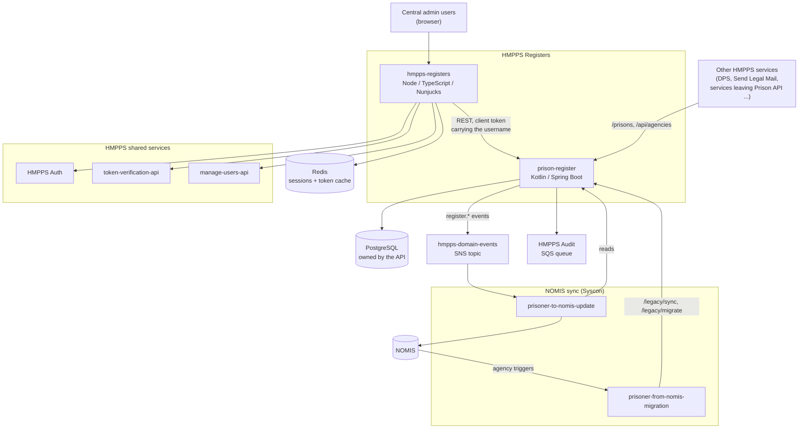
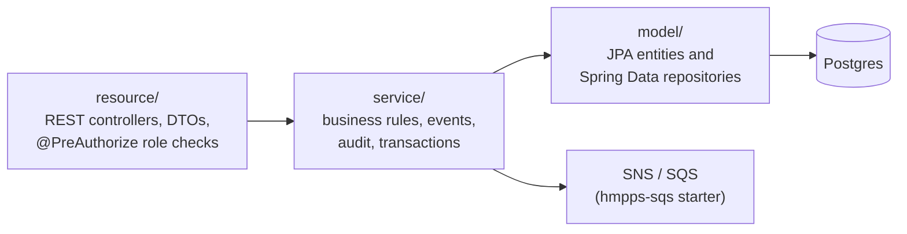
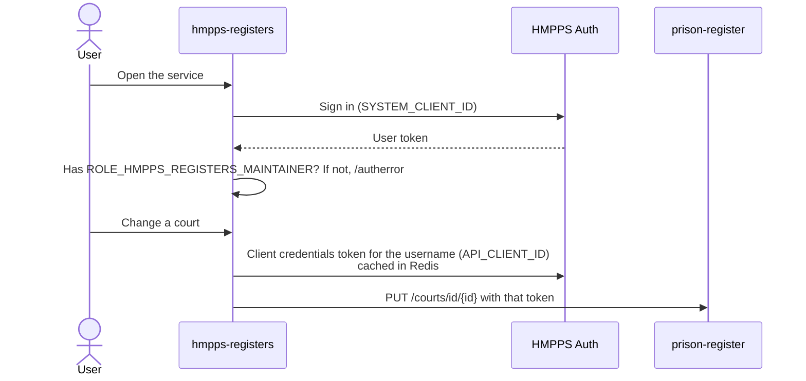

# Architecture

## In one paragraph

HMPPS Registers is the DPS source of truth for **agencies**: prisons, courts, hospitals, probation
offices, police custody suites, approved premises and every other kind of place a prisoner can be
sent to or come from. It replaces the agency maintenance screens in NOMIS, which are now blocked
for users. It is two applications: **prison-register**, a Kotlin API that owns the data, and
**hmpps-registers**, a Node front end that central administrators use to maintain it. Other
services read from the API. Until NOMIS is switched off, two Syscon services keep the register and
NOMIS in step.

The name is historical: the API started as a register of prisons only and kept the name when the
other agency types were added.

## Context

## Repositories and environments

| | API | Front end |
| --- | --- | --- |
| Repository | [prison-register](https://github.com/ministryofjustice/prison-register) | [hmpps-registers](https://github.com/ministryofjustice/hmpps-registers) |
| Dev | `prison-register-dev.hmpps.service.justice.gov.uk` | `registers-dev.hmpps.service.justice.gov.uk` |
| Preprod | `prison-register-preprod.hmpps.service.justice.gov.uk` | `registers-preprod.hmpps.service.justice.gov.uk` |
| Prod | `prison-register.hmpps.service.justice.gov.uk` | `registers.hmpps.service.justice.gov.uk` |
| Namespace | `hmpps-registers-<env>` (both apps share it) | |
| Product id | `DPS098` | `DPS098` |

See [deployment.md](deployment.md) for pipelines, Helm and alerts.

## The API (prison-register)

### Layers

It is a standard HMPPS Spring Boot service (`hmpps-kotlin-spring-boot-starter`,
`hmpps-sqs-spring-boot-starter`, Flyway, JPA, springdoc). Things worth knowing:

- **One controller and one service per agency type**: `CourtResource`/`CourtService`,
  `HospitalResource`/`HospitalService` and so on. They are near copies of each other. A change to
  one usually needs making to all six.
- **Prisons have more controllers** because they are older and hold more data:
  `PrisonResource` (public reads), `PrisonMaintenanceResource` and
  `PrisonAddressMaintenanceResource` (writes), and `PrisonContactDetailsResource` (department phone,
  email and web address).
- **`PublicApiResource` (`/api/agencies`)** gives every agency type in a shape close to Prison
  API's `/api/agencies`, so that services can move off Prison API with little change.
- **`LegacySyncResource` (`/legacy`)** is for the Syscon sync services only; see
  [process-flows.md](process-flows.md#a-change-made-in-nomis).
- Errors are turned into the standard HMPPS `ErrorResponse` by `PrisonRegisterExceptionHandler`.
- Swagger UI is switched on in dev only (`SPRINGDOC_*` in `helm_deploy/values-dev.yaml`).

### Roles

Checked with `@PreAuthorize` on the controllers.

| Endpoints | Role needed |
| --- | --- |
| `GET /prisons/**` | **None.** Open to anything that can reach the service (see `ResourceServerConfiguration`). |
| `GET /api/agencies/**` | `ROLE_HMPPS_REGISTERS_API__R` |
| `/courts`, `/hospitals`, `/probation-offices`, `/police-custody-suites`, `/approved-premises`, `/other-agencies`, `/reference-data`, `GET /legacy/agency/{id}/is-used` | `ROLE_HMPPS_REGISTERS_API__MAINTAIN__RW` |
| Prison writes: `/prison-maintenance/**`, contact detail writes | `ROLE_MAINTAIN_REF_DATA` or `ROLE_MAINTAIN_PRISON_DATA`, **and** the `write` scope |
| `GET /secure/prisons/**` | Any valid token |
| `/legacy/**` (except `is-used`) | `ROLE_HMPPS_REGISTERS_API__SYNCHRONISATION__RW` |

The front end's API client must therefore hold the maintain role and one of the prison data roles.

### Events and audit

Every change made through the maintenance endpoints does two things besides updating the
database:

1. **Publishes a domain event** to the shared `hmpps-domain-events` topic, named
   `register.<type>.<change>` (for example `register.court.amended`,
   `register.hospital.phone.deleted`), with `source` set to `DPS` or `NOMIS`. Events are defined in
   `async-api.yml` and `async-schemas/`, and published by `service/SnsService.kt`.
2. **Sends an audit event** to the HMPPS Audit SQS queue (`service/AuditService.kt`), recording
   the username taken from the token. Changes from the NOMIS sync, and changes to prison contact
   details, are not audited.

## The front end (hmpps-registers)

A standard HMPPS Express template app: TypeScript, Nunjucks views, GOV.UK Frontend, built with
esbuild.

| Path | What lives there |
| --- | --- |
| `server/routes/` | One router and controller per register (`prisonRegister/`, `courtRegister/`, `hospitalRegister/` ...), plus `api/` for the address auto-complete. |
| `server/services/hmppsAgencyRegisterApi.ts` | **Every** call to prison-register. The front end calls no other register. |
| `server/data/` | REST, HMPPS Auth, manage-users and Redis clients. |
| `server/views/pages/` | Nunjucks pages, one folder per register. |
| `server/@types/prisonRegisterImport/` | Types generated from the API's OpenAPI document. **It is a snapshot**, so its role descriptions can be out of date; trust the API code. |
| `integration_tests/` | Cypress specs and WireMock stubs. |

### Journeys

| Register | Path | Can do |
| --- | --- | --- |
| Prisons | `/prison-register` | Search, view, add, change details, addresses (English and Welsh), area fields and CJIT code, mark active or inactive. No delete; department contact details are view only. |
| Courts | `/court-register` | Search, view, add, change every field, addresses, phone numbers, email addresses, activate or deactivate, delete. |
| Hospitals | `/hospital-register` | As courts, but no email addresses. |
| Probation offices | `/probation-office-register` | As courts. |
| Police custody suites | `/police-custody-suite-register` | As courts. |
| Approved premises | `/approved-premises-register` | As courts. |
| Other agencies | `/other-agency-register` | As courts, plus the agency type. |

Add journeys for the six non-prison registers keep their answers in the session under a
`journeyId`, so two tabs do not interfere, and check the new id is unused across **all** agency
types with `GET /legacy/agency/{id}/is-used`. The prison add journey only checks other prisons.

### Sign-in and tokens

- **One role for the whole front end**, `ROLE_HMPPS_REGISTERS_MAINTAINER`, checked in
  `server/app.ts` for every page. There is no read-only access.
- **The API sees the client's roles, not the user's.** Calls to prison-register use a client
  credentials token from `API_CLIENT_ID` with the username attached, so audit records the right
  person, but the API checks the roles of the front end's client.
- The client names are the wrong way round from what you would guess: sign-in uses
  `SYSTEM_CLIENT_*` and API calls use `API_CLIENT_*`.
- **Any 401 or 403 from the API signs the user out** (`server/errorHandler.ts`). If the client is
  missing a role, users are sent to sign-out rather than shown an error.

### Feature flags

| Variable | Effect |
| --- | --- |
| `AGENCY_REGISTER_ENABLED` | Shows the six non-prison register tiles on the home page. It only hides the tiles; the pages still work if you know the address. On in every environment since November 2026. |
| `AGENCY_REGISTER_DELETE_ENABLED` | Shows the delete buttons and allows the delete routes. **Off in production.** |

### Reference data is cached

Areas, regions, local authorities, payroll regions, towns and counties for the auto-complete are
loaded once per pod and kept in memory (`server/routes/api/apiController.ts`). A change to them in
the API shows in the front end only after the pods restart.
