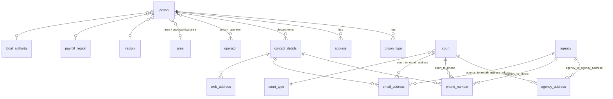

# Data model

The API owns one PostgreSQL database. The schema is managed by Flyway; migrations are in
`src/main/resources/db/migration` and run automatically when the application starts.

## Two families of tables

The register grew in two stages, and the schema still shows it.

1. **Prisons** came first. The `prison` table and its satellites (types, categories, operators,
   addresses, departments and contact details) were built for DPS and hold data that DPS owns, such
   as Welsh names, long-term high-security estate (`lthse`) and departmental phone numbers and email
   addresses.
2. **Every other agency** (courts, hospitals, probation offices, police custody suites, approved
   premises and "other agencies") was added from `V1_44` onwards to replace the NOMIS agency
   screens. These tables mirror the shape of the NOMIS `AGENCY_LOCATIONS` data that they were
   migrated from.



Hospitals, probation offices, police custody suites and approved premises follow the same pattern
as `court`: one main table plus `<type>_to_agency_address`, `<type>_to_phone` and (except
hospitals) `<type>_to_email_address` join tables.

## Main tables

| Table | Holds | Key |
| --- | --- | --- |
| `prison` | Prisons, YOIs and similar establishments | `prison_id` (NOMIS agency id, e.g. `MDI`) |
| `court` | Courts, with `court_type` | `court_id` |
| `hospital` | Hospitals. `high_security = true` is a secure hospital (NOMIS `HSHOSP`) | `hospital_id` |
| `probation_office` | Probation offices (NOMIS `COMM`) | `probation_office_id` |
| `police_custody_suite` | Police custody suites (NOMIS `POLICE` / `POLSTN`) | `police_custody_suite_id` |
| `approved_premises` | Approved premises (NOMIS `APPR`) | `approved_premises_id` |
| `agency` | Every other NOMIS agency type, told apart by `agency_type` (airports, YOTs, secure children's homes, immigration detention centres, PECS and so on) | `agency_id` |
| `all_agencies` | **A view**, not a table. A union of the seven tables above giving `agency_id`, `name` and `legacy_type` | |

All keys are the NOMIS agency id: up to six characters, unique across every agency type. The
`all_agencies` view is how the API checks that an id is not already used by another type
(`GET /legacy/agency/{agencyId}/is-used`).

### Reference data

| Table | Notes |
| --- | --- |
| `area`, `subarea`, `region`, `payroll_region`, `local_authority` | NOMIS geographical and organisational codes, served by `/reference-data`. |
| `type`, `prison_type` | Prison types (HMP, YOI, IRC and so on). `prison_type` is the join to `prison`. |
| `prison_category`, `operator`, `prison_operator` | Prison categories and operators (public sector or the private operator). |
| `court_type` | Court types. |
| `county_suggestions`, `town_suggestions` | Lists that drive the address auto-complete in the front end. |
| `prison_gp_practice` | GP practice codes per prison. No endpoint serves it any more. |

### Contact details

Prison phone numbers, email addresses and web addresses hang off `contact_details`, one row per
**department** (`PRISON`, `SOCIAL_VISIT`, `VIDEOLINK_CONFERENCING_CENTRE`,
`OFFENDER_MANAGEMENT_UNIT`, `OFFICIAL_VISIT`; see `model/DepartmentType.kt`). Other agencies link
straight to `phone_number` and `email_address` through their join tables.

Since `V1_65`, **every owner has its own contact rows**. Two agencies with the same phone number
have two `phone_number` rows. JPA cascade and orphan removal manage their lifetime, so never share
or reuse a row by value.

Phone numbers have **no type**. NOMIS records a phone type (business, fax and so on); the register
does not. Anything that needs "the business phone number" cannot get it from here yet.

## Things that surprise people

- **Prison names are not NOMIS names.** Prison names were standardised in DPS on purpose
  (`V1_22`, for Send Legal Mail envelopes), so `prison.name` deliberately differs from the NOMIS
  description for most prisons. `prison.description` does come from NOMIS.
- **Agency type names are not NOMIS codes.** The register uses names such as `PRISON`, `COURT` and
  `CHILDREN_SECURE_HOME`; NOMIS uses `INST`, `CRT` and `SCH`. The mapping is in
  `PublicApiService.toLegacyAgencyType()`.
- **Migrations that insert reference data are common.** Early migrations (`V1_1`, `V1_5`, `V1_7`,
  `V1_14`, `V1_20` and others) insert prisons by hand. New prisons now arrive from NOMIS through the
  sync; do not add new prisons by migration. See [process-flows.md](process-flows.md#creating-a-new-prison).
- **Secure training centres used to be in two places.** `V1_20` added STC2 and STC3 as prisons
  while NOMIS holds them as agencies of type `STC`. `V1_68` removed the prison rows, so they are now
  only in `agency`.
- **Updating a prison replaces every field.** `PUT /prison-maintenance/id/{id}` sets each field
  of `UpdatePrisonDto` to what it is sent, and anything left out falls back to its default (null,
  false or empty). Always read the prison first and send every field back. Leaving out the Welsh
  name once cleared it whenever a prison was marked active or inactive (MAPB-1125).
- **The `prison_type` id sequence drifted** behind `max(id)` once and broke inserts. `V1_66` reset
  it. If you insert rows with explicit ids in a migration, reset the sequence in the same
  migration.
- **There are no "who changed this" columns.** `config/AuditConfiguration.kt` switches on JPA
  auditing, but no entity uses it. The record of who changed what is in the HMPPS Audit service
  (see [architecture.md](architecture.md#events-and-audit)), not in this database.

## Looking at the data

To query a deployed database, port-forward to it. You need access to the Cloud Platform namespace
`hmpps-registers-<env>`.

```bash
./gradlew portForwardRDS --environment dev --port 8432
```

The task prints the `psql` command and how to get the password. `./gradlew revealSecrets
--environment dev` lists the namespace secrets, and `--secret <name>` shows one of them. These
tasks are defined in this repository's `buildSrc`.
Treat production data with care: names, addresses and phone numbers here are printed on letters
and envelopes.
