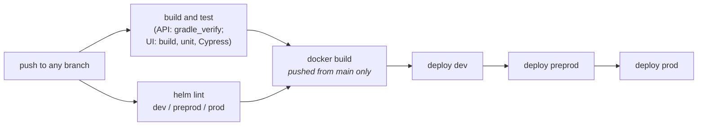

# Deployment

Both applications deploy the same way, with the shared HMPPS GitHub Actions workflows, into the
same Cloud Platform namespaces.

## Environments

| Environment | Namespace | API host | Front end host |
| --- | --- | --- | --- |
| dev | `hmpps-registers-dev` | `prison-register-dev.hmpps.service.justice.gov.uk` | `registers-dev.hmpps.service.justice.gov.uk` |
| preprod | `hmpps-registers-preprod` | `prison-register-preprod.hmpps.service.justice.gov.uk` | `registers-preprod.hmpps.service.justice.gov.uk` |
| prod | `hmpps-registers-prod` | `prison-register.hmpps.service.justice.gov.uk` | `registers.hmpps.service.justice.gov.uk` |

The namespaces' infrastructure (RDS, ElastiCache, SNS subscriptions, SQS, service accounts) is in
[cloud-platform-environments](https://github.com/ministryofjustice/cloud-platform-environments)
under `namespaces/live.cloud-platform.service.justice.gov.uk/hmpps-registers-<env>`. The namespace
names appear nowhere in either application repository; they come from the GitHub environments the
shared workflows use.

> **The API in dev and preprod is switched off at night and at weekends.** Both have
> `scheduledDowntime` in their Helm values: up at 06:30 UTC and down at 21:30 UTC, Monday to Friday
> only. The front end is not, so outside those hours the dev and preprod front ends load but every
> call to the API fails. Plan out-of-hours testing around it.

## Pipeline

Both repositories use `.github/workflows/pipeline.yml`:

- Merging to `main` deploys to dev, then preprod, then prod, one after the other. Any approval
  step comes from the GitHub environment's protection rules, not from the workflow file.
- Images are published to `ghcr.io/ministryofjustice/prison-register` and
  `ghcr.io/ministryofjustice/hmpps-registers`.
- `deploy_to_env.yml` deploys an existing version to one environment by hand.
- The API's Flyway migrations run when the new pods start, so **a migration reaches production as
  soon as the code does**. Make migrations safe to run while the old version is still serving.
- Scheduled scans: CodeQL, Snyk, Veracode, and OWASP (API) or npm audit (front end).

### Deploying the API and the front end together

They deploy separately, so make changes backwards compatible: deploy the API change first, and
only then the front end change that uses it. An API change that breaks the front end's calls
signs users out (any 401 or 403) or shows them an error page.

## Helm

| | API | Front end |
| --- | --- | --- |
| Chart | `helm_deploy/prison-register/` | `helm_deploy/hmpps-registers/` |
| Per-environment values | `helm_deploy/values-<env>.yaml` | `helm_deploy/values-<env>.yaml` |
| Port | 8080 | 3000 |
| Replicas | 2 (dev and preprod), 3 (prod) | 2 (dev and preprod), chart default in prod |
| Memory request / limit | 512Mi / 1Gi (dev), 1Gi / 2Gi (preprod and prod) | Namespace default |

The values files sit one level above the chart in both repositories.

**The API's heap is half its memory limit.** The base image sets `JAVA_TOOL_OPTIONS` to
`-XX:MaxRAMPercentage=50`, so change the memory limit to change the heap. Do not set `JAVA_OPTS`: the
container starts Java directly, so nothing reads it. Java also needs about 320 MB outside the heap,
which is why a 1Gi limit got the production pods killed (MAPB-1101).

Secrets come from Kubernetes secrets in the namespace:

| Secret | Used by | Holds |
| --- | --- | --- |
| `prison-register` | API | HMPPS Auth client for audit, App Insights key |
| `prisons-rds-instance-output` | API | Database endpoint, name and credentials |
| `hmpps-domain-events-topic` | API | SNS topic ARN |
| `sqs-hmpps-audit-secret` | API | Audit queue name |
| `hmpps-registers` | Front end | Both HMPPS Auth clients, session secret, App Insights key |
| `elasticache-redis` | Front end | Redis host and auth token |

**Preprod's database is refreshed from production.** `values-prod.yaml` enables
`postgresDatabaseRestore`, which copies the prod database over preprod. Anything you set up by hand
in preprod will be lost at the next refresh.

## Monitoring

- **Alerts** go to the Move a Prisoner Prometheus alert receivers
  (`move-a-prisoner-alerts-nonprod` and `move-a-prisoner-alerts-prod`), including RDS alerts for the
  API's database. Dev and preprod alert in business hours only.
- **Logs and telemetry** go to Application Insights (`nomisapi-*` workspaces), with
  `cloud_RoleName` `prison-register` and `hmpps-registers`. The API also records custom events such
  as `legacy-sync-prison-updated`, which help trace the NOMIS sync.
- **Health**: `/health` on each app shows its dependencies. Use `/health/ping` (API) or `/ping`
  (front end) to check a service is up; do not point other services at `/health`.
