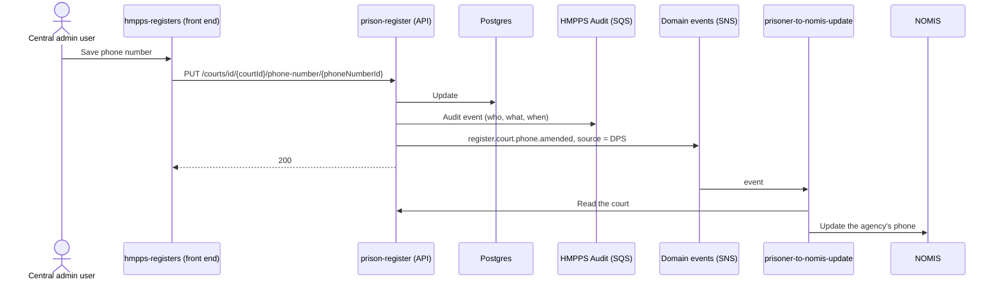
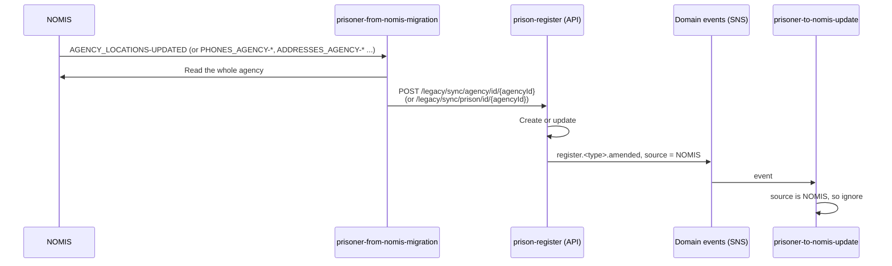
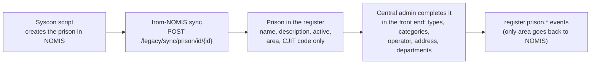
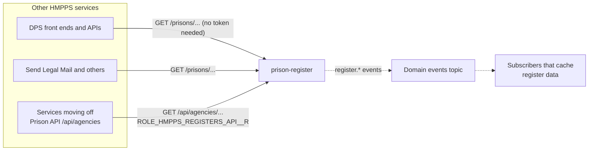

# Process flows

How data moves between the front end, the API, NOMIS and the services that read the register.

The one rule that explains most of this page: **every change raises a domain event that says where
it came from** (`additionalInformation.source` is `DPS` or `NOMIS`). The two Syscon sync services
use that field to stop changes bouncing back and forth.

## A change made in DPS

A central admin user changes a court's phone number in the front end.

Every agency type works this way, with events named `register.<type>.<change>` (for example
`register.hospital.address.inserted`, `register.agency.deleted`). The full list is in
`async-api.yml` and `service/SnsService.kt`.

**Prisons are the exception.** For a prison, only a change of **area** is sent to NOMIS
(`register.prison.area.amended`). Prison names, active flags and contact details changed in DPS stay
in DPS. Prison names in particular are deliberately different from NOMIS; see
[data-model.md](data-model.md#things-that-surprise-people).

## A change made in NOMIS

Until NOMIS is switched off, some agency data still changes in NOMIS (for example by Syscon
scripts). The NOMIS agency maintenance screens themselves are now blocked for users.

Points to know:

- The sync sends the **whole agency** each time, and the API creates it if it does not exist. It
  is an "upsert", so repeating it is harmless.
- `AGENCY_LOCATIONS-DELETED` is not supported. Agencies are made inactive, not deleted.
- For prisons, the sync takes the NOMIS-owned fields (such as description, area and CJIT code) and
  leaves DPS-owned fields alone. `Prison.update` has name and active commented out on purpose.
- The `/legacy/**` endpoints need `ROLE_HMPPS_REGISTERS_API__SYNCHRONISATION__RW`, which only the
  Syscon sync clients should hold.

## Creating a new prison

Prisons are created in NOMIS first, by a Syscon script, and arrive in the register through the
sync. They arrive incomplete, so a central admin user finishes them in the front end.

The front end still has an "Add a new prison" journey. Use it only if you know the prison already
exists in NOMIS or is about to; the later sync updates the same row rather than creating a second
one. Do not add new prisons by Flyway migration.

## Migration and reconciliation

The non-prison agencies were loaded from NOMIS by a one-off migration run from
`prisoner-from-nomis-migration`, using `POST /legacy/migrate/agency/id/{agencyId}`. Migration does
not raise domain events.

`prisoner-to-nomis-update` runs a reconciliation that compares NOMIS with the register, using:

| Endpoint | Returns |
| --- | --- |
| `GET /legacy/reconciliation/ids/all` | The ids of every non-prison agency |
| `GET /legacy/reconciliation/prison/ids/all` | The ids of every prison |
| `GET /legacy/reconciliation/{agencyId}` | One agency, in the NOMIS-shaped `LegacyAgencyDto` |

Differences are reported to Application Insights. The reconciliation stops at the first difference
for each agency, so it understates how many fields differ.

> **`DELETE /legacy/admin/sync/agency/all` deletes every non-prison agency.** It exists to reset an
> environment before a fresh migration. Nothing in the code limits it to dev. Only the sync role can
> call it; do not give that role to anything else.

## How other services read the register

| Endpoint group | Use it for | Role |
| --- | --- | --- |
| `GET /prisons`, `/prisons/id/{id}`, `/prisons/names`, `/prisons/search`, `POST /prisons/prisonsByIds` | Prison details for DPS screens and letters. | None. `/prisons/**` is open to any caller that can reach the service. |
| `GET /api/agencies`, `/api/agencies/{id}`, `/api/agencies/type/{type}`, `/api/agencies/legacy-type/{nomisCode}` | Any agency type, in a shape close to Prison API's `/api/agencies`. The replacement for Prison API agency lookups. | `ROLE_HMPPS_REGISTERS_API__R` |
| `GET /secure/prisons/id/{prisonId}/department/contact-details?departmentType=...` | A prison department's phone, email and web address. | Any valid HMPPS Auth token. Changing them needs `ROLE_MAINTAIN_REF_DATA` or `ROLE_MAINTAIN_PRISON_DATA` with write scope. |

`/api/agencies/{id}` returns an agency whether it is active or not. The list endpoints return
active agencies only, unless called with `activeOnly=false`. The `/api/agencies` list endpoint reads
every agency table in full on each call, so callers should cache the answer rather than call it per
request.
